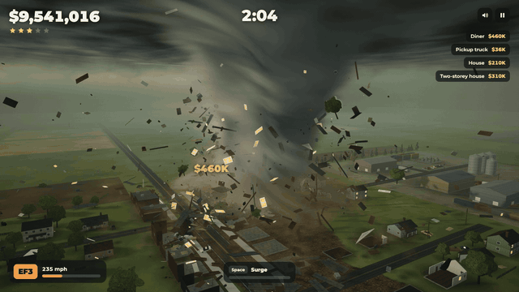
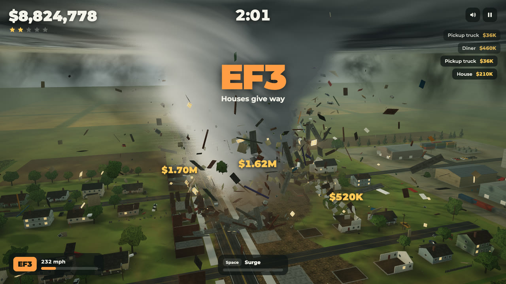
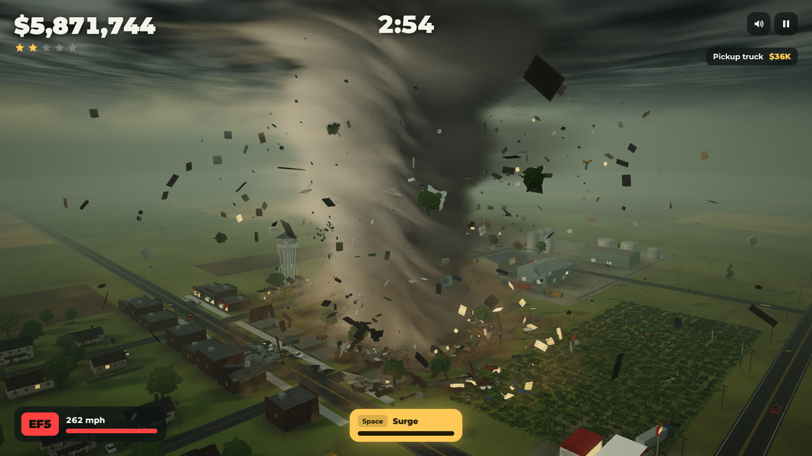
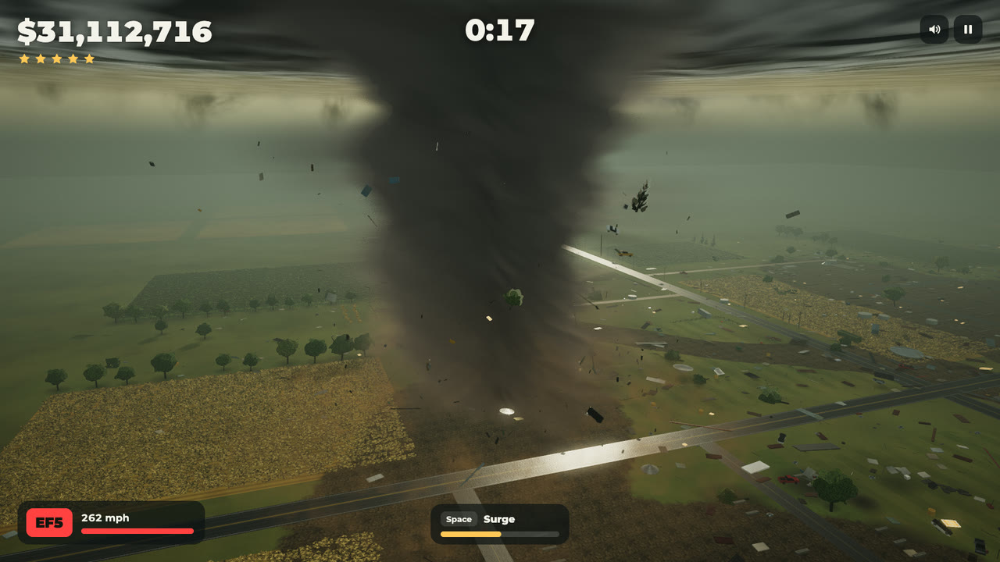

# Tornado Simulator: Storm County

A destruction game in Babylon.js and TypeScript where you are the tornado. Start as a thin rope over a farm, grow from EF0 to EF5 and take a whole county apart in three minutes.

[](https://oryn.dev/games/tornado-simulator)

**[Play it in your browser](https://oryn.dev/games/tornado-simulator)**, no download needed. It also runs on phones.

## What is inside

- A three-minute run with five stars and a best score, plus a sandbox where you set size and wind
- Six storm stages: each one rips up something new, from trees and cars to silos and warehouses
- A county of farms, suburbs, crops, roads and an industrial edge that really breaks apart
- Surge: a charged burst that makes the storm wider and stronger for a few seconds
- A volumetric funnel, storm sky, rain, lightning and flying debris in custom shaders
- Three quality levels that step down by themselves, and keyboard, gamepad and touch controls

<p>
  
  
  
</p>

## Start it on your computer

You need [Node.js](https://nodejs.org) 20.19 or newer.

```bash
git clone https://github.com/oryn-dev/babylonjs-tornado-simulator.git
cd babylonjs-tornado-simulator
npm install
npm run dev
```

Then open the address it prints, usually http://localhost:5173.

`npm run build` writes the finished game to `dist/`. It is a plain static folder, so you can put it on any web host or upload it to itch.io as an HTML game.

## Controls

| | Keyboard and mouse | Gamepad | Touch |
| --- | --- | --- | --- |
| Steer | W A S D or arrow keys | Left stick | Drag on the left |
| Look around | Drag with the mouse | Right stick | Drag on the right |
| Surge | Space | A | Surge button |
| Pause | Esc or P | Start | Pause button |

## Change it

| File | What it does |
| --- | --- |
| `src/game/game.ts` | Where the game starts |
| `src/game/sim/tornado.ts` | How the storm moves and grows |
| `src/game/sim/damage.ts` | What breaks when, and what it is worth |
| `src/game/world/plan.ts` | The map of the county |
| `src/game/weather/` | Funnel, sky and weather shaders |
| `src/game/ui/` | Menus and HUD |
| `game/tuning.json` | 41 values such as run length, growth and surge |
| `game/look.json` | Sky, light, fog and post effects |
| `public/assets/` | Models, textures, sounds and fonts |
| `src/oryn/` | A small base around Babylon.js: start, light, input, sound, saves, settings |

`npm run typecheck` checks the types.

## Open it in Oryn

The project follows the layout of [Oryn](https://oryn.dev), so you can open it there and keep building by chat, with the game running next to it.

1. Sign in at [oryn.dev](https://oryn.dev) and start a new game.
2. Choose **From GitHub** in the menu next to the prompt.
3. Paste `https://github.com/oryn-dev/babylonjs-tornado-simulator` as the public repository URL and press **Import project**.

You get your own copy. This repository stays as it is.

## Make it yours

A few things you could ask for after the import:

- "Move the storm to a harbour town with ships and cranes"
- "Add a storm chaser car that I have to catch"
- "Two tornadoes, two players, who wrecks more?"

When you like the result, publish it as a page anyone can play, or export it as a [mobile app](https://oryn.dev/mobile-game-maker) for Android and iOS or as a Windows, Mac, Linux or Steam build. Exports need a paid plan, and you publish with your own store accounts.

## More games with source

- [Furnace Choir](https://github.com/oryn-dev/babylonjs-boomer-shooter), a boomer shooter
- [Moth Hour](https://github.com/oryn-dev/babylonjs-bullet-hell), a bullet hell
- [Deep Salvage](https://github.com/oryn-dev/babylonjs-submarine-game), a submarine game
- [Channel 6: Night Shift](https://github.com/oryn-dev/babylonjs-horror-game), a horror game

## License

The code and our own assets are [MIT](LICENSE): use them, change them, sell what you make. Third-party assets and libraries are listed in [ASSETS.md](ASSETS.md). The Oryn name and logo are not part of the license.
